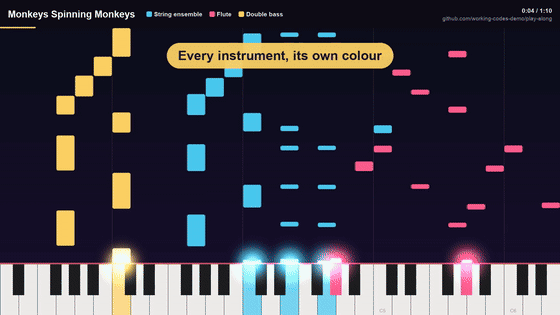

<div align="center">

# ▶ play-along

**Any song in. A falling-notes play-along out, with every instrument in its own colour.**



[**▶ Try it in your browser**](https://working-codes-demo.github.io/play-along/) ·
[Demo video](demo/teaser.mp4) · [Quick start](#quick-start) · [How it works](#how-it-works) · [Cite](#citation)


</div>

---

Falling-notes videos are how a lot of people learn songs, but making one needs a MIDI file first, and they're usually piano only.
**play-along makes one from the recording itself**, for every instrument in it:

```bash
python play.py --input song.mp3                      # or a YouTube link
```

- **Every instrument, its own colour.** Clarinet, flute, bass, strings and piano each get a colour; drums light up their own pads.
- **A practice player, not just a video.** Solo one instrument and **hear it on its own** (built-in synth), mute the rest,
  slow to 0.5× without changing pitch, loop the bar you're stuck on. One HTML file that works offline.
- **Piano is split into hands.** When the piano is the only pitched instrument, right and left hand get their own colours, so you can practise one at a time.
- **Any source.** MP3, WAV, a video file, or a **YouTube / SoundCloud link** (via yt-dlp). `--start` / `--end` take part of a long track.
- **Multi-track MIDI too**, one track per instrument, ready for your DAW or notation app.
- **Runs on a laptop.** The transcription model is 28M parameters. A 70 s song takes about 35 s on an M3 laptop.

## Demo

**[Open the browser demo →](https://working-codes-demo.github.io/play-along/)** Four songs, each with the practice player.

| Song | What was found | Try |
|---|---|---|
| "Fluffing a Duck" (Kevin MacLeod, CC BY 4.0) | electric piano, clarinet, flute, synth strings + 299 drum hits | solo the clarinet, hear it alone |
| "Monkeys Spinning Monkeys" (Kevin MacLeod, CC BY 4.0) | string ensemble, flute, double bass | mute the strings, follow the bass |
| "Sneaky Snitch" (Kevin MacLeod, CC BY 4.0) | string ensemble, double bass, electric piano + drums | hide the strings, hear the bass line in Synth |
| Chopin, Nocturne Op. 9 No. 2 (public domain recording) | piano, split into right and left hand | learn the left hand at 0.5× |

## Quick start

```bash
git clone https://github.com/working-codes-demo/play-along.git
cd play-along
python3.12 -m venv .venv && source .venv/bin/activate
pip install -r requirements.txt            # the models (~120 MB) download on the first run

python play.py --input my_song.mp3
python play.py --input "https://www.youtube.com/watch?v=..." --start 30 --end 90
```

Tested on YouTube with Big Buck Bunny (CC BY): its orchestral score comes out as harp, strings, flute and cello.

Results land in `results/<song>/`:

| File | What it is |
|---|---|
| `player.html` | the practice player: open it in a browser (works offline) |
| `playalong.mp4` | 720p falling-notes video with the original audio |
| `song.mid` | multi-track MIDI, one track per instrument + drums |
| `notes.json` | every note: onset, offset, pitch, velocity, per instrument |
| `audio.mp3` | the audio the player plays |

Make practice videos from an existing run, without transcribing again:

```bash
python play.py --rerender results/my_song --solo clarinet              # only the clarinet lit up
python play.py --rerender results/my_song --solo "left hand" --speed 0.5
python play.py --rerender results/my_song --size 1080x1080             # square, for social posts
```

### Options

| Flag | Default | |
|---|---|---|
| `--start`, `--end` | whole song | use only part of the recording (seconds) |
| `--solo NAME` | all | highlight one instrument, the others are dimmed (repeatable, partial names work) |
| `--speed` | `1.0` | slow the video and audio together, pitch kept |
| `--size` | `1280x720` | video size, e.g. `1920x1080`, `1080x1080` |
| `--title` | file / video title | title in the video |
| `--no-hand-split` | off | keep the piano as one track |
| `--no-video` | off | only notes, MIDI and the player |
| `--rerender DIR` | | new video from an earlier run, no model |
| `--device` | auto | `cuda`, `mps` or `cpu` |

## How it works

```
song.mp3 / YouTube link
  │  yt-dlp + ffmpeg → 44.1 kHz WAV (the drum model needs ≥ 40 kHz)
  ▼
dettato (4 small models, 28M parameters)
  │  transcriber → evidence repairer → instrument grouper, + drum model
  ▼
notes per instrument  ──►  piano the only pitched part? split into right / left hand at middle C
  │
  ├─►  renderer (OpenCV)   → playalong.mp4   falling notes, keyboard fitted to the song's range, drum pads, glow
  ├─►  player.html         → canvas + Web Audio: solo / mute, synth per instrument family, 0.5×, A–B loop
  └─►  song.mid, notes.json
```

The player plays the **original recording** by default. Switch to **Synth** and it plays only the instruments you kept,
using a small Web Audio synth with a different sound for each instrument family (piano, strings, reeds, flutes, bass,
drums). That's how you hear one part on its own, even though the recording has them all mixed together.

## Performance

Apple M3 Pro laptop (MPS):

| Song | Length | Transcribe | 720p video |
|---|---|---|---|
| Fluffing a Duck | 67 s | 29 s | 24 s |
| Chopin Nocturne Op. 9 No. 2 (excerpt) | 75 s | 39 s | 27 s |

Peak memory is about 1.2 GB. On a CPU-only machine expect a few times slower.

Tests (no model download needed): `pip install pytest && python -m pytest -q`

## Limitations

- **It's a transcription, so it isn't perfect.** Notes are sometimes missed, and some land on the wrong instrument
  (the model's author notes this is weakest on dense jazz). Treat it as a guide to play along with, not sheet music.
- **Performance timing, not a score.** Notes keep the recording's exact timing. There is no tempo map or bar lines.
- **Instrument names are the model's guess** at the closest General MIDI instrument.
- **The hand split is a fixed line at middle C.** It doesn't follow a hand that crosses over.
- **The synth is simple.** It's for hearing a part clearly, not for sounding like the real instrument.
- **Drums need a ≥ 40 kHz source.** play-along converts to 44.1 kHz, but a low-quality source still sounds low-quality.
- **Copyright:** transcribe music you have the right to use. The demo uses only public-domain and CC-licensed recordings.

## Citation

If you use play-along in a paper, video or project, please cite this repository
(GitHub's **"Cite this repository"** button gives the same entry in APA and BibTeX):

```bibtex
@software{play_along_2026,
  author  = {Kumar, Yogesh},
  title   = {play-along: Turn Any Song into a Falling-Notes Play-Along Video and Practice Player},
  year    = {2026},
  version = {0.1.0},
  url     = {https://github.com/working-codes-demo/play-along},
  license = {Apache-2.0}
}
```

A ⭐ on the repo also helps other people find it.

## Acknowledgements

- [dettato](https://github.com/kobimusic/dettato): audio-to-MIDI transcription models (code and weights Apache-2.0),
  downloaded from Hugging Face on first run.
- [yt-dlp](https://github.com/yt-dlp/yt-dlp), [FFmpeg](https://ffmpeg.org), [OpenCV](https://opencv.org), [pretty_midi](https://github.com/craffel/pretty-midi).
- Demo music: Kevin MacLeod (incompetech.com, CC BY 4.0) and a public-domain Chopin recording. See [CREDITS.md](CREDITS.md).

## License

[Apache License 2.0](LICENSE). Videos and MIDI made from the demo songs follow the songs' licenses (see [CREDITS.md](CREDITS.md)).
